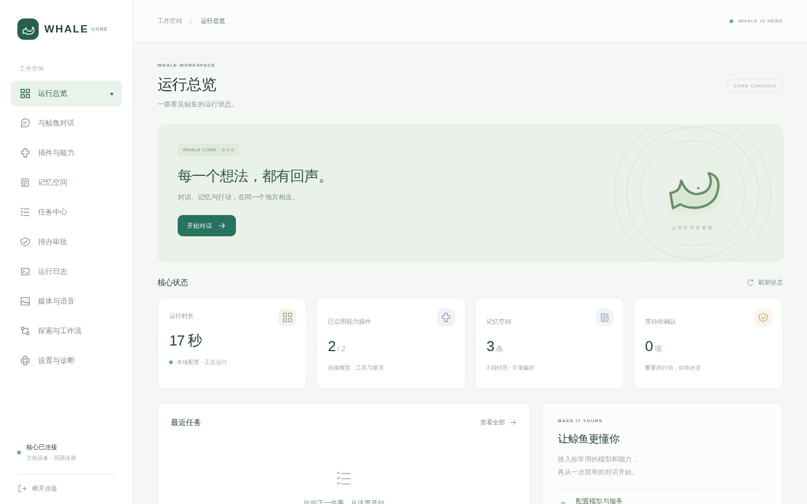
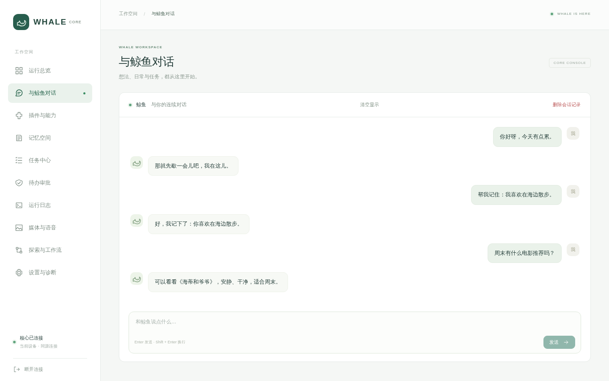
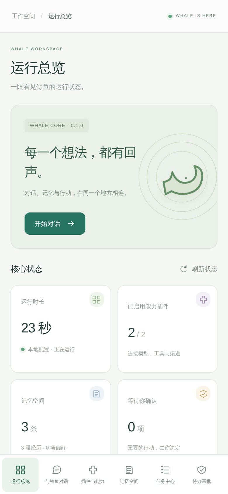

<div align="center">

# whale-core

*山有木兮木有枝，心悦君兮君不知*

鲸鱼的核心大脑：对话、记忆、工具、语音与主动探索。

[English](README_EN.md) · [使用与部署](docs/deployment.md) · [能力配置](docs/media-and-voice.md) · [开发者指南](docs/AI_DEVELOPMENT_GUIDE.md)

[Fork：V2 逐轮更新说明](docs/v2-updates/README.md)

</div>

## 这是什么

whale-core 是鲸鱼的核心大脑，也是一个可扩展的 AI 伴侣与行动智能体。它把对话、人格、长期记忆、意图判断、工具与主动行为组织在一起，让鲸鱼既能聊天，也能通过设备观察环境、作出选择和完成任务。「电子女友」是其中一种体验形态，不是能力边界。

角色人格来自用户选用或导入的角色卡，核心不内置角色禁忌表，也不通过系统提示词限制扮演与日常互动。设备操作、外部工具和记忆访问则通过真实执行权限处理，不交给角色提示词判断。

网页控制台、QQ、手机、通话与眼镜共享这套智能层。Android 感知和执行在 [whale-mobile](https://github.com/amwangfan/whale-mobile)；QQ/WeQ 渠道与历史桥接见 [whale-io](https://github.com/amwangfan/whale-io)。

本仓库提供核心库、命令行、管理 API、网页控制台，以及 Linux/macOS 桌面入口和容器部署。没有生产用 mock/demo 档：需要模型或服务的功能走真实端点，缺配置会明确报错。官方搜索与 QQ 渠道插件随安装包分发；第三方目录插件按显式路径加载，不做自动发现。

## 界面

以下截图来自本地临时配置和示例数据，不含真实账号、令牌或服务凭据。







## 可以做什么

| 功能 | 当前实现 | 使用条件 |
| --- | --- | --- |
| 对话与记忆 | 多轮历史、人格、SQLite、记住/忘掉、会话恢复、记忆浏览与删除、聊天收图（可当参考图） | 可用的 OpenAI 兼容文字模型；收图需要多模态模型 |
| 搜索与阅读 | 搜索、抓取、保留来源链接、组合阅读工作流 | Tavily / Brave 密钥，或把 `WHALE_SEARCH_PROVIDER` 设为 `bing` / `ddg` 走免 key 档；免 key 档可能被反爬 |
| 插件与设置 | 清单、真实启停、持久配置、连接测试、即时生效、分角色模型（意图/执行/审核）、每日请求预算、人格禁忌、诊断 | 控制台设置；第三方清单还需宿主提供执行器 |
| 工具任务 | 持久轨迹、步骤与期限、取消、逐项审批与恢复、慢任务先回执后补发、进程重启后恢复在途任务 | 高风险动作始终经过策略层；未知外部结果不会自动重试 |
| 语音与媒体 | ASR、TTS、生图、Wan 异步视频、私有产物；TTS 产物可发成 QQ 语音消息，图片可图文混排发送 | 按需配置 DashScope 兼容平台或 OpenAI 兼容端点；配置与联调边界见[能力配置](docs/media-and-voice.md) |
| 实时语音 | 原生 Realtime WSS 会话（浏览器麦克风、打断、人格与记忆、转写写入记忆）；另有 whale-io PCM 中继低延迟通话 | 兼容 Realtime 协议的服务与 `voice` 可选依赖；PCM 中继尚未与真实音频桥联调 |
| 语义记忆 | 可选真实 embedding 与关键词融合、失败回退、缓存清理 | 配置 OpenAI 兼容 embedding 端点；未配置时只用关键词 |
| 主动探索 | 兴趣、真实搜索阅读、候选草稿、静默时段、配额、退避、定期 worker、暂停 | 定期探索默认关闭；外发另需已绑定的渠道派发器 |
| QQ 与表达 | 群聊/私聊、人格卡、分段回复、群聊参与时机与长度软适配、主动问候 | 依赖已配置的 QQ/WeQ 渠道；发送状态以真实回执为准 |
| 天气与情境 | QWeather 实况与预报、位置上下文、搜索回退 | 配置和风 API 或搜索提供方；无位置时使用已配置的默认城市 |
| 设备与自主体 | 设备配对、权限视图、实时观察、动作回执；Android observe → decide → control/shell 编排器 | 设备端执行在 whale-mobile；自主体循环已有代码与模拟测试，生产接线及 Root 真机完整联调仍待完成 |
| 结果投递 | 文字/图片向 QQ 私聊投递，眼镜接口可调用；离线结果暂存 | 手机图库正式写入能力未接通，服务器暂存不等于送达手机 |
| 受控终端 | personal 档下 owner 自由命令免逐次审批、工作目录限制、输出与资源边界、Linux Bubblewrap 沙箱（独立用户/PID/网络命名空间、进程额度） | 非 root、可用的 Bubblewrap + prlimit；不可用时拒绝执行 |
| 备份与恢复 | JSONL 记忆交换、完整 SQLite 备份/恢复 | 恢复前停止服务；完整配置和媒体还需备份数据目录 |

控制台包含总览、对话、媒体与语音、探索与工作流、插件、记忆、任务、审批、事件和设置十个页面，页面按需加载并支持手机布局。保存配置和批准操作都以服务器实际结果为准。

## 结构与技术栈

| 层 | 实际实现 | 主要技术 |
| --- | --- | --- |
| 核心对话与任务 | `src/whale_core/core/`、`life/` | Python 3.11、OpenAI 兼容 HTTP API、异步任务编排 |
| 记忆 | `memory/` | SQLite；可选 embedding 与关键词融合 |
| 工具与外部能力 | `plugins/`、`cloud/` | 插件接口、HTTP、Shell 与模型工具调用 |
| 设备管理 | `devices/`、`api/devices_api.py` | Ed25519、WebSocket、V2 协议、回执与持久化记录 |
| 管理界面 | `api/`、`web/` | Python 服务端、React / TypeScript |
| 手机执行端 | [whale-mobile](https://github.com/amwangfan/whale-mobile) | Kotlin、Android 前台服务、Flutter |

**已经接通**：对话/记忆/插件基本链路、Web 管理、设备身份与 V2 WSS、设备通知/查询/动作的管理入口。**仍待接通/验收**：ADB/SSH 与 WSS 的统一生产动作入口，完整的多设备自主任务调度，专用 Root 手机连续应用操作，以及真实眼镜显示回执。

`DeviceGatewayV2` 目前是多传输编排组件，不是生产 REST 的唯一入口；它的内存回执仅用于本进程，跨重启幂等仍依赖已有 `EmbeddedWssGateway` 的持久化记录。具体接口和缺口见 [设备文档](docs/devices.md)。

## 从源码开始

需要 Python 3.11+；构建前端使用 Node 24 和 pnpm 12。

```bash
git clone https://github.com/amwangfan/whale-core.git
cd whale-core
python -m pip install -e ".[dev,voice]"
pnpm -C web install --frozen-lockfile
pnpm -C web build
whale api
```

打开终端显示的本机地址（默认 http://127.0.0.1:8080），粘贴首次生成的访问 token，然后在「设置」填写模型端点、名称和密钥，点击保存、测试连接。token 保存在配置目录的 `api_token`，不会放进网页 URL。

文字模型没有厂商绑定。默认 `local` 指向 `http://127.0.0.1:11434/v1`，请在设置中填写本地实际安装的模型名；`cloud` 默认 DeepSeek，也可改成其他兼容服务。项目不会替你下载或启动模型。

命令行用法：

```bash
whale setup --profile local
whale doctor
whale run
whale plugins list
whale memory backup /private/backups/whale.sqlite3
```

`cloud` 的命令行初始化需要先设置 `DEEPSEEK_API_KEY`；网页首次设置可以直接保存私密凭据。新配置目录默认 `~/.whale`，也可给命令增加 `--config-dir PATH`。同一数据目录同时只允许一个服务实例。

## 安装包、桌面与容器

带控制台的 wheel 可在没有 Node 的机器上运行，并带上官方插件与内置工作流；Linux/macOS 也有免 Python 可执行构建。Windows 端不在本轮实现范围。

```bash
# 仓库内构建并验证带控制台的 wheel
python scripts/build_release.py
python scripts/verify_wheel.py dist/*.whl

# 桌面：可选原生窗口；缺少窗口依赖时使用系统浏览器
whale desktop
# 或 whale desktop --browser

# Linux 云端/本机服务：默认只向本机映射端口
# docker compose up --build -d
```

原生窗口需要 `desktop` 可选依赖和系统 WebView。免 Python 可执行（PyInstaller）默认用系统浏览器；Linux/macOS 的 wheel 与冻结包已由 GitHub CI 构建并通过独立启动检查。macOS 签名、公证和真实图形环境验收仍需单独执行，不在自动化测试范围内。构建、菜单入口、容器、升级、日志和备份步骤见[部署说明](docs/deployment.md)与[桌面说明](docs/packaging-desktop.md)。

## 数据、授权与运行状态

管理 API 使用 Bearer 鉴权，默认监听本机；公网部署按[部署说明](docs/deployment.md)配置 HTTPS。模型端点、密钥、记忆和产物存放在用户的本地配置/数据目录，相关设置可以在网页控制台调整。记忆支持浏览、导出和删除。

鲸鱼可以在用户授予的权限内自主行动。日常手机的感知与操作按设备 scope 和授权状态执行；专用 Root 手机支持在启用模块与持续 Root 授权后执行 Shell、观察和界面操作。服务器的 Shell 沙箱是另一条执行路径，不应与 Android Root 权限混为一谈。

任务面板显示执行、失败与结果未知等状态；批准代表允许执行，不保证外部操作已经完成。原始语音、截图及媒体产物的实际处理方式见[能力配置](docs/media-and-voice.md)和[设备文档](docs/devices.md)。

## 开发文档

文档入口与完整清单（含历史阶段文档归档）见 [docs/README.md](docs/README.md)。

- [管理 API](docs/management-api.md)
- [设备与意图契约](docs/contracts.md)
- [能力与语音配置](docs/media-and-voice.md)
- [Shell 沙箱](docs/shell-sandbox.md)
- [贡献指南](CONTRIBUTING.md)
