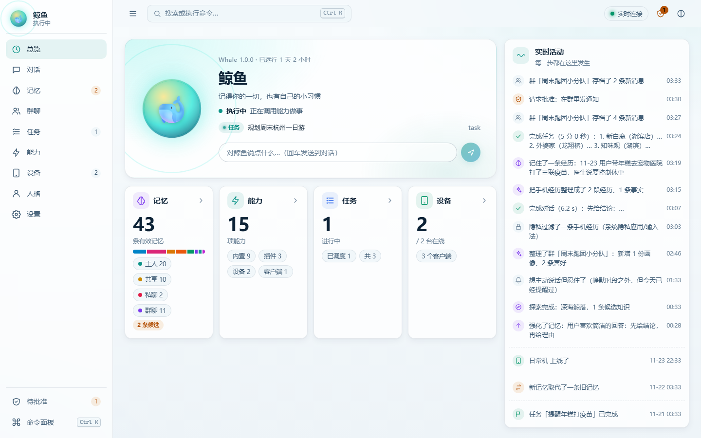
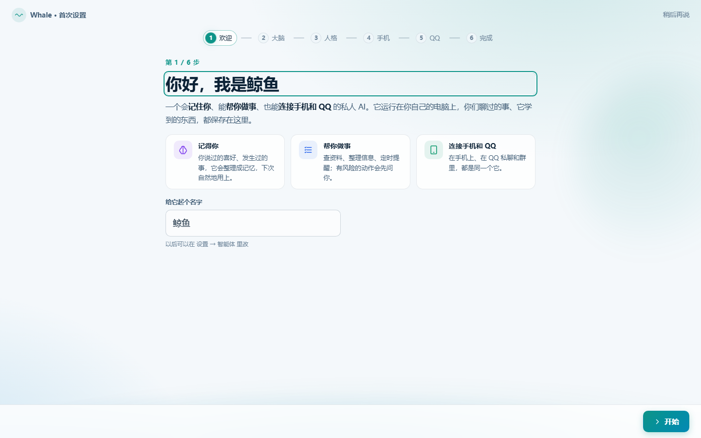
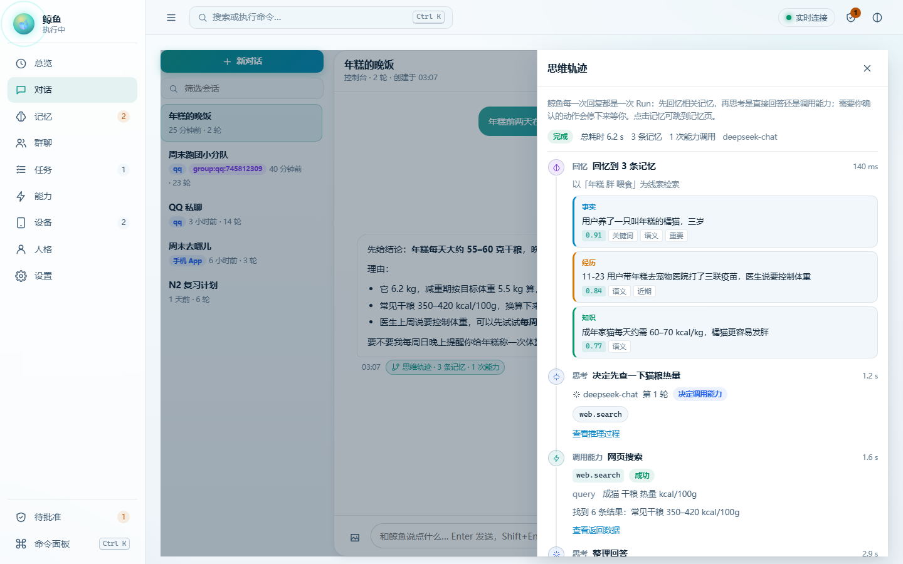
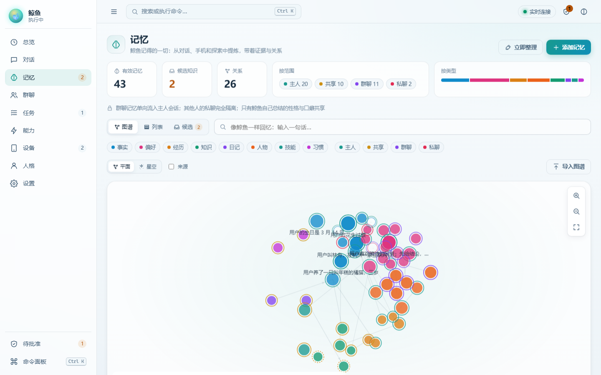
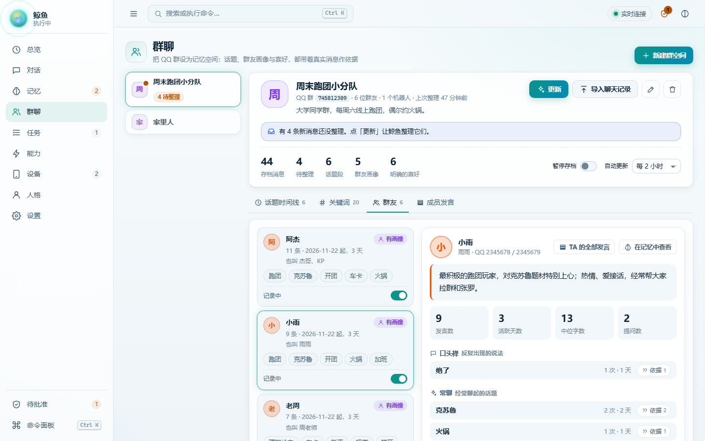
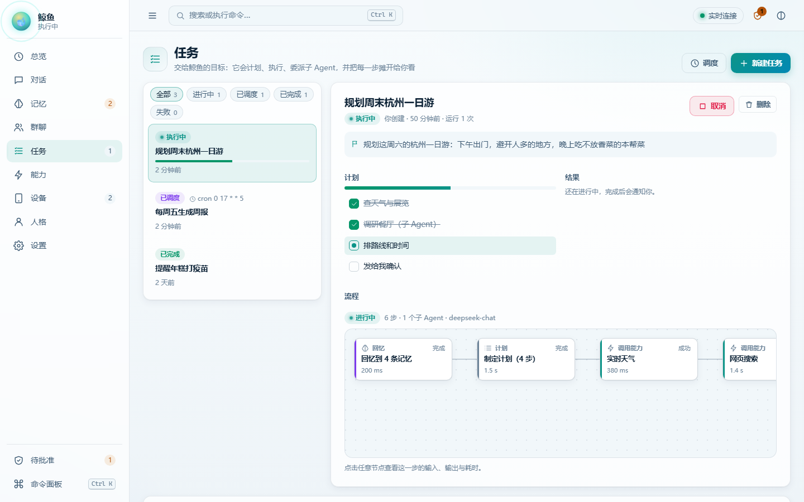
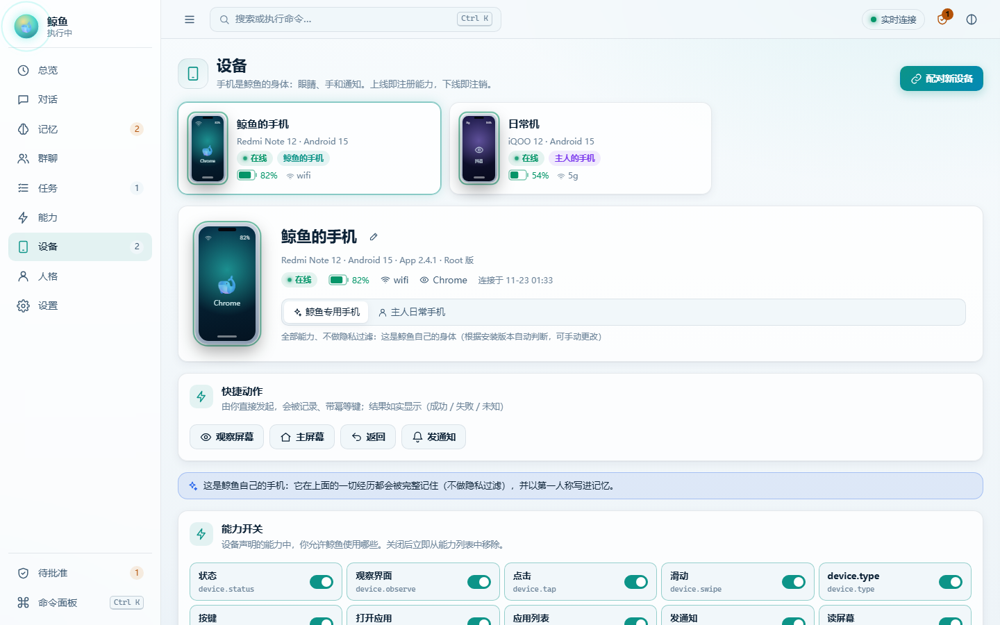

<div align="center">


# 鲸鱼 Whale

**一个住在你电脑里、会记住你、能帮你做事的私人 AI。**

*山有木兮木有枝，心悦君兮君不知*

[下载安装](#安装) · [第一次使用](#第一次使用) · [能做什么](#它能做什么) · [手机端 whale-mobile](https://github.com/amwangfan/whale-mobile) · [常见问题](#常见问题)

</div>



## 这是什么

**whale-core 是鲸鱼的「大脑」**：它运行在你自己的电脑（或家里的 NAS、云服务器）上，负责思考、记忆、做计划和调用各种能力；同时自带一个**网页控制台**，打开浏览器就能和它聊天、查看它记住了什么、它在做什么。

- **它是后端**：所有数据（聊天、记忆、设置）都保存在你自己的电脑上，不经过任何第三方服务器；只有在思考时，才把这一轮对话发给你选择的大模型（DeepSeek、通义千问、Kimi……或者完全离线的本机模型）。
- **它也带前端**：网页控制台就是它的「驾驶舱」，不用装任何别的软件。
- **手机是它的身体**：配合 Android 手机端 [whale-mobile](https://github.com/amwangfan/whale-mobile)，鲸鱼可以在手机上和你聊天、给你推送提醒、记住你在手机上看过的东西，甚至替你操作手机。
- **QQ 是它的社交圈**：接入 QQ 后，它可以在私聊和群聊里像朋友一样说话，记住群友的说话方式和喜好。

和普通聊天机器人不同，鲸鱼**会长期记住你**：你说过的喜好、经历、身边的人，它都会整理成记忆，并在之后的对话里自然地用上——而且每一条记忆都能追溯到你当时的原话，你可以随时查看、修改或让它忘掉。

## 安装

### Windows（推荐）

在开始菜单里打开 **PowerShell**，粘贴下面这一行并回车：

```powershell
irm https://raw.githubusercontent.com/amwangfan/whale-core/main/scripts/install.ps1 | iex
```

它会自动准备好运行环境（没有 Python 会帮你装），并在桌面放一个「**鲸鱼 Whale**」图标。以后**双击图标**就能启动，浏览器会自动打开控制台；关闭那个黑色窗口即停止。再运行一次这行命令就是升级，记忆和设置不会丢。

> 也可以在本页右上角 **Code → Download ZIP** 下载解压后，双击里面的 `Whale.cmd`（需要先装好 [Python 3.11+](https://www.python.org/downloads/)，安装时勾选 *Add python.exe to PATH*）。

### macOS / Linux

```bash
curl -fsSL https://raw.githubusercontent.com/amwangfan/whale-core/main/scripts/install.sh | bash
whale
```

### NAS / 家庭服务器 / 云主机（Docker）

```bash
git clone https://github.com/amwangfan/whale-core.git && cd whale-core
docker compose up -d
docker compose logs whale   # 里面有带令牌的控制台链接
```

## 第一次使用

启动后浏览器会自动打开控制台，并进入一个几分钟的**设置引导**：



1. **给它起个名字**（默认叫「鲸鱼」）。
2. **选择大脑**：从 DeepSeek、通义千问、Kimi、智谱 GLM、硅基流动、OpenAI、OpenRouter 里选一个，点「去获取 Key」注册并复制 API Key 粘贴进来，点「连接并测试」——看到它回你一句话就成功了。想完全离线，可以选 **Ollama（本机模型）**。暂时没有 Key 也可以先跳过，用内置的离线模式体验界面。
3. **选择人格**：用默认的，或者导入你喜欢的角色卡（兼容 SillyTavern / Character Card V2）。
4. **连接手机**（可选）：打开「允许局域网里的手机连接」，在手机 App 里填上显示的地址和 6 位配对码。
5. **连接 QQ**（可选）：之后在「设置 / 能力」里接入。

> 控制台地址形如 `http://127.0.0.1:8080/?token=…`，令牌会保存在浏览器里。以后忘了令牌，运行 `whale token` 即可查看。

## 它能做什么

### 聊天，并且看得见它在想什么

流式回复、可以发图片。每一条回复都能展开「**思维轨迹**」：它想起了哪几条记忆、为什么想起、调用了什么工具、每一步花了多久。需要对外发消息、操作手机或执行命令时，会先停下来**等你批准**。



### 长期记忆，有据可查

- 每轮聊天后，它会在后台整理出你**明确说过**的事实、喜好和经历——必须有你的原话做依据，不会凭空推测。
- 说过的事情重复了就加深印象；你更正了（「其实我的猫叫团子」）就用新记忆取代旧的；相关的事情会自动连成网。
- 不常想起的琐事会慢慢淡忘，你也可以随时让它彻底忘掉某件事。
- 「记忆」页可以用**关系图**、**3D 星空**或列表浏览所有记忆，点开任何一条都能看到来源。



**记忆有边界**：你和它的私聊是它最核心的记忆；群聊里学到的东西可以在你们的私聊里用上，但你的私事**永远不会**被带进群聊；其他人和它的私聊完全隔离。只有它自己慢慢形成的说话习惯、口头禅会在各个对话里保持一致。详见 [记忆边界](docs/MEMORY.md)。

### 群聊记忆空间

把一个 QQ 群设为记忆空间后，群里的聊天会保存在你的电脑上；点一下「更新」，鲸鱼会整理出：

- **话题时间线**：这个群最近都在聊什么，每段讨论的关键词；
- **群友画像**：每个人的口头禅、常聊的话题、典型反应（比如总是第一个附和、喜欢提议开团）；
- **明确说过的喜好**：「我最喜欢克苏鲁的模组」这样的原话。

每一条画像和喜好都能点「依据」看到当时的原始发言。不想被记住的群友可以单独关闭，已记录的内容会一并删除。也可以导入 [QQ Chat Exporter](https://github.com/shuakami/qq-chat-exporter) 导出的历史聊天记录。



### 交给它一个目标

在「任务」里写一个目标（「帮我调研几款家用 NAS，给出推荐」），它会自己写计划、一步步执行、把子问题交给「子 Agent」并行处理，最后给你结论。任务可以只做一次，也可以定时（每天早上 8 点）或周期执行；聊天里说「每小时提醒我喝水」，它会自己创建提醒。整个过程以**流程图**展示，进行到哪一步一目了然。



### 连接手机

配对 [whale-mobile](https://github.com/amwangfan/whale-mobile) 后，手机就成了鲸鱼的身体：

- **在手机上聊天**、接收它的提醒和审批请求；
- **日常手机**：在你允许的范围内记住你在手机上看过、做过的事（锁屏、密码框、输入法、银行和密码管理器等隐私界面**永远不会记录**，你还可以排除任何应用和网站），每 30 分钟整理成记忆。你可以直接问「我刚才在手机上看的那个视频叫什么？」
- **给鲸鱼专用的手机**：它可以自己点按、滑动、打开应用、执行命令，完成你交代的手机上的事。



### 更多

| | |
| --- | --- |
| **主动探索** | 空闲时按你的兴趣上网搜索阅读，写「探索日记」，发现值得一说的会主动告诉你（有静默时段和每日次数上限） |
| **人格** | 编辑性格、说话方式、背景设定；导入角色卡；它在相处中形成的习惯也会显示在这里 |
| **能力与权限** | 网页搜索/阅读、天气、生图、语音合成、执行命令、QQ 收发……每项能力都可以设为「允许 / 先问我 / 禁止」 |
| **QQ** | 通过 OneBot（NapCat、LLOneBot 等）或 WeQ 接入；私聊自然对话，群聊被 @ 时回应，或者让它自己判断要不要插话 |
| **眼镜** | 支持雷鸟智能眼镜的上下文与日程同步 |
| **离线可用** | 没有配置模型时也能体验界面、记忆和任务；选择 Ollama 可完全离线运行 |

## 数据与隐私

- 所有数据都在你自己的电脑上：默认目录是 `C:\Users\<你>\.whale`（macOS/Linux 为 `~/.whale`），里面的 `whale.db` 是记忆和聊天，`secrets.json` 是各种密钥。备份就是复制这个文件夹。
- 控制台只在本机打开（`127.0.0.1`）；只有你在设置里打开「允许局域网连接」后，同一网络里的手机才能连上。所有访问都需要令牌，手机需要配对码。
- 大模型服务商只会收到当前这一轮对话需要的内容（你的问题、相关的几条记忆）。

## 常见问题

**浏览器没有自动打开？** 复制黑色窗口里「打开控制台」后面的链接到浏览器即可。

**提示端口被占用？** 鲸鱼会自动换一个端口，以窗口里显示的地址为准。

**手机连不上？** 确认电脑和手机在同一个 Wi-Fi，并已在「设置 → 服务」打开「允许局域网里的手机连接」后重启；Windows 第一次可能会弹出防火墙提示，选择「允许」。

**换一个大模型？** 「设置 → 模型」里可以添加多个服务商，并分别指定聊天、快速任务（记忆整理）、看图、语义检索用哪个模型。

**怎么升级？** 重新运行一次安装命令。

## 给开发者

whale-core 用 Python（Starlette）编写，控制台是无需构建的 ES Modules（Preact + htm）。

```bash
git clone https://github.com/amwangfan/whale-core.git && cd whale-core
python -m pip install -e ".[dev]"
python -m pytest -q
whale --data ./.whale-dev
```

- [架构](docs/ARCHITECTURE.md)：一条主干——每个输入都是一个 Run（回忆 → 思考 → 调用能力 → 回复），每一步实时可见、可回放
- [协议](docs/PROTOCOL.md)：Link 协议（一个 WebSocket 承载 RPC、事件与能力声明），以及与手机端的设备协议
- [记忆边界](docs/MEMORY.md) · [开发指南](docs/DEVELOPMENT.md) · [控制台](web/README.md)

## 致谢

群聊记忆空间来自 [@Ksupotco](https://github.com/Ksupotco) 的贡献（[#95](https://github.com/amwangfan/whale-core/pull/95)）。手机隐私规则参考了 [ScreenMemo](https://github.com/woijfwefw/ScreenMemo)。
