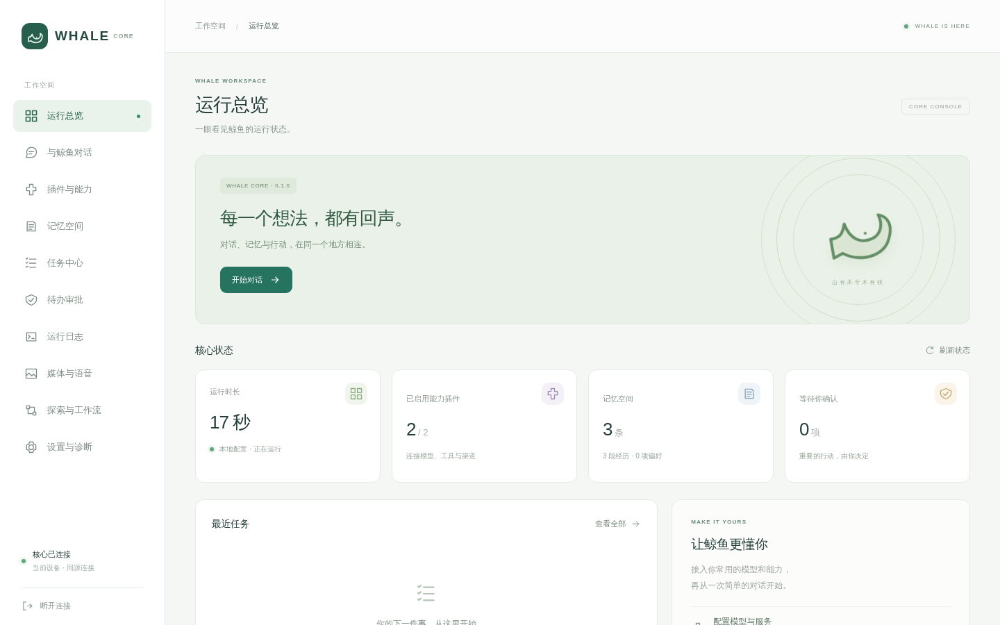
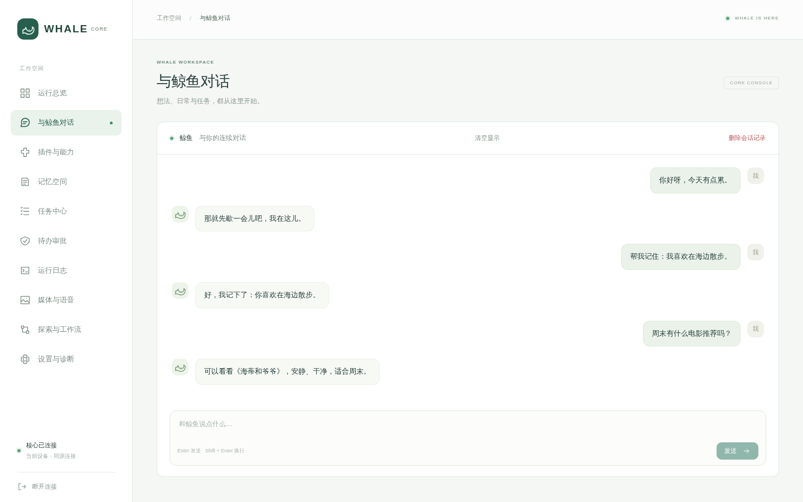
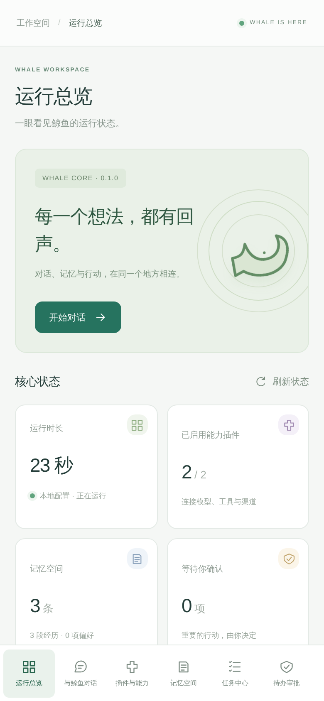

<div align="center">

# whale-core

*“The mountain has trees, and trees have branches; my heart delights in you, yet you do not know.”*

Whale's core brain: conversation, memory, tools, voice and exploration.

[中文](README.md) · [Deployment](docs/deployment.md) · [Capabilities](docs/media-and-voice.md) · [Developer guide](docs/AI_DEVELOPMENT_GUIDE.md)

</div>

## What it is

whale-core is Whale's shared brain: an extensible AI companion and agent that combines conversation, persona, long-term memory, intent routing, tools and initiative in one intelligence layer. It can chat, perceive through connected devices, make decisions and carry out tasks. A virtual girlfriend is one possible experience, not the limit of the project.

Personas come from character cards the user selects or imports; the core ships no built-in persona taboo list. Device actions, external tools and memory access are governed by real execution permissions, not by persona prompts.

The console, QQ, phones, calls and glasses share this intelligence layer. Android perception and actions live in [whale-mobile](https://github.com/amwangfan/whale-mobile); the QQ/WeQ channel bridge lives in [whale-io](https://github.com/amwangfan/whale-io).

The repository provides the core library, a CLI, a management API, a web console, Linux/macOS desktop entry points and container deployment. The official search and QQ channel plugins ship with the packages; third-party directory plugins load only from explicit paths, with no auto-discovery.

## Interface

The screenshots below come from a local temporary setup with sample data; they contain no real account, token or service credentials.







## What it can do

| Feature | What is implemented | Requirements |
| --- | --- | --- |
| Conversation and memory | Multi-turn history, persona, SQLite persistence, remember/forget, session restore, memory browsing and deletion, image input (usable as a reference image); older episodes from the same conversation are recalled by relevance | An OpenAI-compatible text model; image input needs a multimodal model |
| Search and reading | Search, fetch, source links, combined reading workflows | Tavily / Brave keys, the DeepSeek Search API, or set `WHALE_SEARCH_PROVIDER` to `bing` / `duckduckgo` for keyless providers; keyless providers may be rate-limited by bot checks |
| Plugins and settings | Manifests, real enable/disable, persistent config, connection tests, hot switching, per-role models (intent/execution/safety review), daily request budgets, persona taboos, diagnostics | Console settings; third-party manifests still need a host-provided executor |
| Tool tasks | Persistent traces, step and deadline limits, cancellation, per-action approval and resume, two-phase slow tasks (acknowledge, then deliver), recovery of in-flight tasks after restart | High-risk actions always pass the policy layer; unknown external outcomes are never retried automatically |
| Voice and media | ASR, TTS, image generation, asynchronous Wan video, private artifacts; TTS output can be sent as QQ voice messages and images can be mixed with text | A DashScope-compatible platform or OpenAI-compatible endpoints, configured as needed; see [capability configuration](docs/media-and-voice.md) for setup and integration boundaries |
| Realtime voice | Native Realtime WSS sessions (browser microphone, interruption, persona and memory, transcripts written to memory); plus a whale-io PCM relay for low-latency calls | A Realtime-compatible service and the optional `voice` extra; the PCM relay has not been tested against a real audio bridge |
| Semantic memory | Optional real embeddings fused with keyword recall, fallback on failure, cache cleanup; raw chat episodes are recalled by relevance only and never auto-promoted into long-term facts | An OpenAI-compatible embedding endpoint; keyword recall keeps working without it |
| Proactive exploration | Interests, real search and reading (including read-only discovery of public Bilibili video pages), candidate drafts, quiet hours, quotas, backoff, scheduled worker, pause | Scheduled exploration is off by default; outbound delivery needs a bound channel dispatcher |
| QQ and expression | Group/private chat, persona cards, multi-part replies, proactive greetings; the intent model chooses semantically whether to join a group conversation or observe | Requires a configured QQ/WeQ channel, and an intent model for semantic participation; delivery depends on actual send receipts |
| Weather and context | QWeather conditions and forecasts, location context, web-search fallback | A QWeather API or search provider; a configured default city when location is unavailable |
| Glasses backend | Trusted phone identity (token authentication, owner binding), `/v1/chat` (companion/quick modes, with a parallel second reply polled over `/v1/chat/followup`), context and phone-calendar snapshot sync (events / empty / unreadable as three distinct states), result delivery (text/images, with TTS audio sendable as QQ voice messages), RayNeo ingest/query/control endpoints | The phone bridge client and glasses credentials |
| Devices and autonomy | Pairing, device scopes, observation, action receipts and an Android observe → decide → control/shell loop | Execution runs in whale-mobile; the loop has code and simulated tests but is not yet wired into a production entry point or fully validated on a Root phone |
| Result delivery | Text/images to QQ DMs and a glasses-facing API; offline artifact staging | Native phone-gallery writes are not connected; staging on the server is not delivery to the phone |
| Controlled terminal | Tiered authorization: owner free-form commands in the personal tier run without per-command approval, other members are denied by default; execution is isolated in a Linux Bubblewrap sandbox with working-directory, output and resource bounds; see the [Shell sandbox](docs/shell-sandbox.md) for details | Non-root Linux with working Bubblewrap + prlimit; execution is refused when unavailable |
| Backup and restore | JSONL memory exchange, full SQLite backup/restore | Stop the service before restoring; back up the config and artifact directories for full recovery |

The console has twelve pages: overview, chat, studio, plugins, memory, tasks, initiative, approvals, events, media and voice, exploration and workflows, and settings. Pages load on demand and support mobile layouts. Configuration saves and approvals always reflect the server's actual result.

## Architecture and stack

| Layer | Implementation | Main technologies |
| --- | --- | --- |
| Core conversation and tasks | `src/whale_core/core/`, `life/` | Python 3.11+, OpenAI-compatible HTTP APIs, async task orchestration |
| Memory | `memory/` | SQLite; optional embeddings fused with keyword recall |
| Tools and external capabilities | `plugins/`, `cloud/` | Plugin interfaces, HTTP, Shell and model tool calls |
| Device management | `devices/`, `api/devices_api.py` | Ed25519, WebSocket, V2 protocol, receipts and persisted records |
| Glasses and phone services | `api/glasses.py`, `api/rayneo_http.py` | Token authentication, parallel follow-up channel, calendar snapshots, unified result delivery |
| Management UI | `api/`, `web/` | Python server, React / TypeScript |
| Phone execution | [whale-mobile](https://github.com/amwangfan/whale-mobile) | Kotlin, Android foreground service, Flutter |

See the [device documentation](docs/devices.md) for device interfaces and contracts.

## Roadmap

- Native writes to the phone system gallery
- A unified production action entry across ADB/SSH and WSS, and unified task scheduling across devices
- The on-device glasses display and draw-receipt loop
- Full on-device validation of continuous app operation on a dedicated Root phone
- Integration testing of the PCM call relay against a real audio bridge
- A Windows desktop build; macOS signing, notarization and real GUI acceptance

## Start from source

Python 3.11+; the frontend needs Node 24 and pnpm 12.

```bash
git clone https://github.com/amwangfan/whale-core.git
cd whale-core
python -m pip install -e ".[dev,voice]"
pnpm -C web install --frozen-lockfile
pnpm -C web build
whale api
```

Open the local address printed by the server (default http://127.0.0.1:8080), paste the access token generated on first launch, then fill in the model endpoint, name and key on the Settings page, save and test the connection. The token lives in `api_token` inside the config directory and is never placed in a URL.

Text models are not vendor-locked. The default `local` profile points at `http://127.0.0.1:11434/v1`; enter the model name actually installed on that server. `cloud` defaults to DeepSeek and can be changed to another compatible service. The project does not download or start a model for you.

CLI usage:

```bash
whale setup --profile local
whale doctor
whale run
whale plugins list
whale memory backup /private/backups/whale.sqlite3
```

Cloud CLI setup requires `DEEPSEEK_API_KEY`; the web setup page can store private credentials directly. The default config directory is `~/.whale`, and `--config-dir PATH` overrides it. Only one service instance may use a data directory at a time.

## Packages, desktop and containers

The wheel includes the compiled console, the official plugins and the built-in workflow, so it runs on machines without Node; Linux/macOS also have Python-free executables.

```bash
# Build and verify a wheel with the console
python scripts/build_release.py
python scripts/verify_wheel.py dist/*.whl

# Desktop: optional native window; falls back to the system browser
whale desktop
# or whale desktop --browser

# Linux server: maps the port to localhost by default
# docker compose up --build -d
```

Native windows need the `desktop` extra and a system WebView. Python-free builds (PyInstaller) default to the system browser; GitHub CI builds and isolated-startup-checks the Linux/macOS wheel and frozen packages. See [deployment](docs/deployment.md) and [desktop packaging](docs/packaging-desktop.md) for build, menu entry, container, upgrade, logging and backup steps.

## Data, permissions and execution status

The management API uses Bearer authentication and listens on localhost by default; see [deployment](docs/deployment.md) for HTTPS hosting. Model endpoints, credentials, memory and artifacts live in the user's configuration/data directory. Settings are managed in the console; memories can be browsed, exported and deleted.

Whale acts autonomously within the permissions granted to it. A daily-use phone follows device scopes and its authorization settings; a dedicated Root phone supports Shell, observation and UI controls once its module and persistent Root grant are enabled. The server-side Shell sandbox is a separate execution path, unrelated to Android Root.

Tasks distinguish succeeded, failed and unknown outcomes. Approval permits an action but does not guarantee an external operation has completed. See [capabilities](docs/media-and-voice.md) and [devices](docs/devices.md) for audio, screenshots and artifact handling.

## Development docs

See [docs/README.md](docs/README.md) for the documentation index.

- [Management API](docs/management-api.md)
- [Device and intent contracts](docs/contracts.md)
- [Capability and voice configuration](docs/media-and-voice.md)
- [Shell sandbox](docs/shell-sandbox.md)
- [Contributing](CONTRIBUTING.md)
