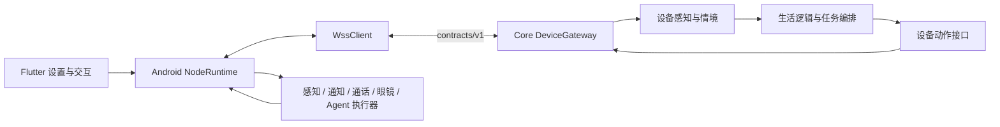

# Core 与 Mobile 的互联边界

本文按当前实际入口梳理开发路径，便于分批精简。协议保持 `contracts/v1` 不变；canonical 位于 whale-mobile，Core 保存版本化镜像。



## 入口与职责

| 责任 | Core | Mobile |
| --- | --- | --- |
| 配对、身份与权限 | `api/devices_api.py`、`devices/registry.py` | `DeviceIdentity.kt`、配对界面 |
| 长连接与心跳 | `devices/gateway.py` | `transport/WssClient.kt`；生命周期由 `runtime/NodeRuntime.kt` 管理 |
| 感知上行 | `sensor.event` → `devices/perception.py` → 消费与情境 | 原生采集模块 → NodeRuntime → WssClient |
| 动作下行 | 编排 → `DeviceActionPort` → `GatewayActionPort` → 网关 | WssClient → 注册执行器 → `action.receipt` |
| 大输出查询 | `GatewayOutputReadPort` → `sensor.query` | 原生或 Dart 查询处理器 → `sensor.result` |
| 手机自主体 | `devices/agent_loop.py` 观察、决策和步骤状态 | `modules/agent/` 观察、UI 与 Root Shell 执行 |

表中 Kotlin 路径相对 Mobile 的 `app/android/app/src/main/kotlin/com/wangfanlab/whale/`；Core 路径相对 `src/whale_core/`。

## 本次收拢

`devices/actions.py` 是设备动作的稳定接口，集中定义：

- `DeviceActionPort`：下发动作的结构化接口。
- `DeviceUnavailable`：携带协议错误码的不可用异常。
- `RECEIPT_STATES` 和 `TERMINAL_RECEIPT_STATES`：中间态与终态的统一集合。
- `validate_action_receipt` 与 `ActionReceiptError`：设备层回执校验；旧生活层入口保留 `AutonomyError` 异常兼容。

生产网关、模拟设备和生活逻辑共用这一份定义。`life.autonomy` 继续导出旧名字，已有调用方和异常捕获保持兼容。生活层负责提议、审批，并调用设备层校验回执；本次不改动作权限或重试规则。

## 后续精简候选与验收边界

1. 回执校验已迁到设备层，`devices/agent_failures.py` 不再导入 `life/autonomy.py`。旧生活层函数只转接异常，保留原错误码与消息。
2. Mobile 顶层 `modules/`、`transport/` 包含独立模块和历史资料；不能仅因 Android 使用 `app/` 就整目录删除，应先核对构建脚本、测试和引用。
3. Core 的自主体有编排与模拟测试，生产决策入口及 Root 真机完整链路仍需单独验收。
4. 手机图库投递尚未形成完整 Mobile API；Core 暂存不等于送达，不在本批中改成完成状态。

## 联合检查

能力词表由 Mobile 的 `scripts/generate_capabilities.py` 从现有协议生成，Core 的 `devices/capabilities.py` 是发布时随包携带的生成文件，不在运行时读取另一个仓库。详细流程见 [Mobile 互联开发说明](https://github.com/dreaminutes/whale-mobile/blob/refactor/simplify-integration/docs/device-interop-development.md)。

在 Core checkout 内运行：

```sh
python -m pip install -e '.[dev,devices]' -r ../whale-mobile/server/requirements.txt
python scripts/check_device_interop.py --mobile ../whale-mobile --log-dir ../logs/04-device-interop
```

在 Mobile checkout 内运行 `python tests/contract_validate.py`，需要 jsonschema。真实设备、Root、语音和眼镜需要另行联调；离线测试不能替代这些验收。
