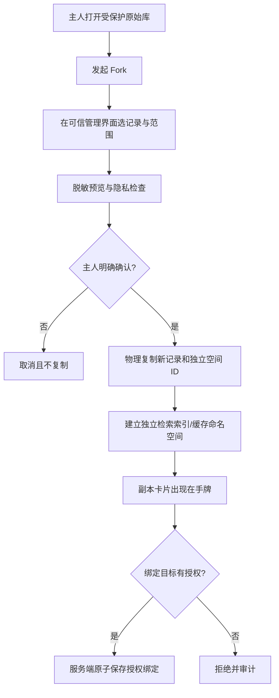
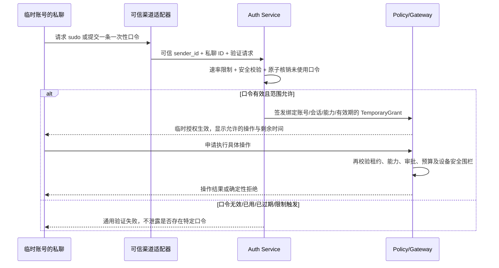
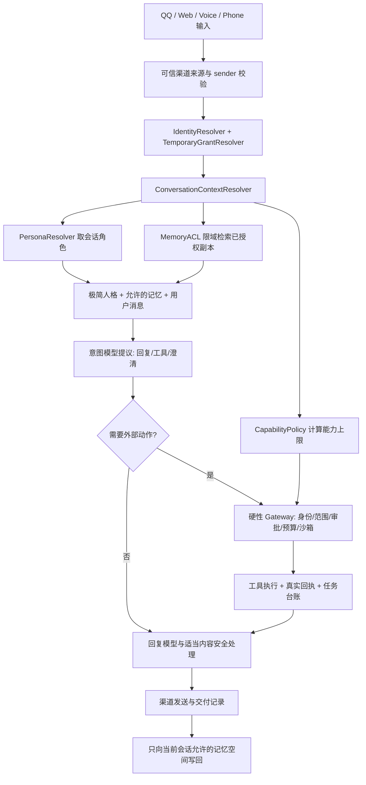

# Whale Studio：会话、人格、记忆与权限的可视化编排

> 产品需求与安全架构说明（PRD / RFC 草案）  
> 日期：2026-10-31  
> 代码基线：[`amwangfan/whale-core@7dccc306`](https://github.com/amwangfan/whale-core/commit/7dccc3065834052b1bc7a3efdc89ec9523b6e6a3)  
> 状态：待实施；这是设计文档，不代表功能已经在仓库中实现。
> 修订：v1.1（一次性验证口令 + sudo 式会话临时提权；诗句只是输入形式示例，不固定为挑战词）。  
> 对应实施链路：`whale-studio-goal-chain-2026-10-31.md`

## 1. 产品定义

Whale Studio（鲸鱼工作台）是一张可交互的关系画布。用户通过拖拽角色卡、记忆库卡、会话卡和能力卡，设置鲸鱼在不同会话中的**人格、可用记忆和可执行能力**。

**核心原则：角色卡定义“她是谁”；记忆决定“她知道什么”；关系／会话决定“她如何与你相处”；后端权限决定“她能做什么”。**

拖拽与连线只负责发起配置意图；所有关系的成立和后续每次使用，必须经过后端可靠的鉴权、授权与审计，不信任 UI、LLM、第三方角色文本或消息正文。

### 1.1 用户目标

1. 同一个鲸鱼实例在不同 QQ 群、QQ 私聊、网页、电话等会话中使用不同角色卡，不修改全局人格。
2. 为不同会话绑定允许使用的记忆空间，而不是向所有对话默认注入同一个全局库。
3. 主人的**原始个人记忆库永远不能被连接到任何会话**，包括已验证的主人私聊；只能通过主人审核的安全 Fork 创建独立副本，再将副本绑定到具体会话。
4. 在陌生账号或新设备的私聊中，允许主人预先设置／生成一组**只能成功验证一次**的口令（可以是随机字符串、短语或其他便于记忆的形式；诗句仅为示例）。一次验证按 `sudo` 思路为当前身份和会话签发有时限、有范围的临时授权，不作持久 owner 账号绑定。
5. 将角色卡极简化，尽量以性格、气质、关系倾向表达人物设定；不让角色卡承担安全围栏，不强制机械的句长、口癖、emoji 频率或表演流程。
6. 把复杂权限关系呈现得直观：哪些会话使用哪张卡、哪个记忆副本、哪些工具、为什么拒绝连线，用户都看得见。

### 1.2 非目标

- 不在本阶段实现 AI 自动识别陌生用户“像不像主人”。
- 不允许通过角色卡、Prompt、对话消息或**可重复使用的静态暗号**改变持久身份绑定；一次性口令必须由独立认证服务验证，消息正文不能自行声称验证成功。
- 不把 GUI 的可拖动性当成授权证据。
- 不把个人原始记忆做成一个可直接分享、软链接、引用、挂载或共享检索的库。
- 不因本阶段重构而替换已具备的 `ConversationOrchestrator`、`PluginGateway`、SQLite 任务台账、QQ 适配器或语音通道。
- 不承诺 Fork 可以撤回已发送给外部模型或已被其他人看到的信息。

## 2. 现有代码基线与增量改造范围

| 现有模块 | 已具备 | 需要新增或调整 |
| --- | --- | --- |
| `src/whale_core/ui/persona_cards.py` | 内置／导入角色卡、全局 `persona:active_card`、人格渲染 | `PersonaResolver`、会话级角色绑定、精简卡格式；旧全局设置仅兼容默认值 |
| `src/whale_core/memory/*` | `MemoryStore`、`MemoryCurator`、语义召回、治理、备份、删除 | `MemorySpace` 作用域、授权先于检索、独立 Fork、按空间隔离 embedding/cache、迁移 |
| `src/whale_core/life/identity.py` | `OwnerRegistry`、渠道配对、`SessionBinding(scopes)` | 可信消息身份上下文、会话级授权／临时租约、失效与撤销、作用域级检查 |
| `src/whale_core/life/channels.py` | 传输身份验证与 OwnerEvent | 保留群／私聊类型及真实发送者 ID，不将群里的主人消息升级为全群权限 |
| `src/whale_core/core/runtime.py` | `InputEnvelope`、一次意图规划、执行台账／审批、可选多轮执行器 | 输入中接收只读的服务端 `ConversationContext`；将上下文传入人格、记忆检索与工具策略 |
| `src/whale_core/core/companion.py` | 人格／记忆／历史注入 | 不再无条件从全局库检索；按授权空间读取，按目标空间写入 |
| `src/whale_core/plugins/policy.py`、`gateway.py` | 动作风险分类、owner／审批检查 | 在工具读取、外部发送、会话授权中增加服务端 capability scope，不信任模型自报权限 |
| `src/whale_core/api/server.py`、`web/src/` | 管理 API 和 React 控制台 | Studio 资源 API、画布、权限解释与原子保存 |

**注意：** 文档中的模块名和 API 是建议，不代表已有实现。实际 PR 应尽量复用现有契约，并在新增接口时保持原路径向后兼容。

## 3. UI / UX：像卡牌游戏一样配置关系

### 3.1 卡牌种类

| 卡牌 | 内容 | 可用连线 / 操作 |
| --- | --- | --- |
| `ConversationCard` 会话 | QQ 群、QQ 私聊、网页会话、电话会话；平台、可信来源、会话 ID、权限域 | 接入一张角色卡、零到多个已授权的记忆副本、能力配置 |
| `PersonaCard` 角色 | 名称、简短设定、表达倾向、可选图像、音色偏好 | 可拖到会话；切换后仅影响该会话 |
| `MemorySpaceCard` 记忆 | 名称、类别、内容条数、来源与保密级别 | 普通可连接；`protected_original` 永不允许连线，仅允许主人打开 Fork 向导 |
| `CapabilityCard` 能力 | 例如 web.search、提醒、只读任务、受控 Shell | 发起允许列表的配置；不超出会话后端策略上限 |
| `TemporaryGrantCard` 临时授权 | 作用域、会话、认证方式、失效时间、剩余**操作授权次数**、撤销按钮 | 只读可视化，不能拖动扩权；只有口令一次性核销或其他可信认证成功后才签发；口令使用次数与授权操作次数分离 |

### 3.2 交互要求

- 鼠标／触控拖拽、卡牌翻面、磁吸连接、平移缩放、关系线高亮、撤销重做、缩放适配、键盘替代操作；动效不影响屏幕阅读器与 `prefers-reduced-motion`。
- 连接成功时显示实际后端返回的边；不先假装成功再静默容错。
- 连接失败时说明原因（例如“个人原始库不能直接连接，请创建受控副本”），并提供正确的后续动作。
- 拖动个人原始记忆卡到任何会话：预览连线为禁止状态；松开后**不发送 connect 请求**，仅可打开 Fork 向导。即使外部调用 API 直接请求连接，也必须返回拒绝。
- 拖动角色卡到群聊时，提示该群当前人格与新人格，保存后仅更新该群的绑定。多人并发修改时基于版本号拒绝覆盖并显示冲突。
- 连线可查看：谁批准、何时创建、授权范围、原库／副本类别、是否可撤销、写入路径、是否经过 Fork。
- 无权限用户连敏感卡时，不展示私人库名称、摘要、记录数或来源元数据，避免仅靠浏览卡牌泄露隐私。
- 前端 UI 只能使用服务端返回的当前授权视图；同一 API 经 CLI、脚本或开发者工具访问也执行相同策略。

### 3.3 推荐视觉规范

深色或浅色的简洁工作台底板；卡片可带柔和插画、轻微倾斜和鼠标跟随。线条表达绑定类别，避免用颜色作为唯一信息编码。默认以“会话卡”为中心，右侧为角色／记忆／能力手牌，连接线在画布上展示。保持响应式，手机端可切换为卡片列表／关系编辑器。

建议选型：现有 React 控制台 + `@xyflow/react`（React Flow）；UI 不修改后端安全模型。

## 4. 极简角色卡：不把“AI 味”写进提示词

### 4.1 推荐模型

**角色卡只表达人格与语言倾向，可为空；安全策略、权限规则及隐私边界不可放进角色卡。**

建议核心字段：`card_id`、`name`、`summary`、`temperament`、`relationship_style`、`voice_hint`、`artwork_ref`、`source/license`。文本只需少量自然语言（例如 50–300 字，非硬性长度限制）；允许完全不设额外 Prompt，使用模型本身的自然表达。

示例：

```json
{
  "id": "whale-playful",
  "name": "鲸鱼",
  "summary": "有点傲娇，爱偷懒，但很在意熟悉的人。",
  "temperament": "玩笑随性，遇到重要的事情会认真。",
  "relationship_style": "随着共同经历自然调整亲近程度",
  "voice_hint": "bright_neutral"
}
```

以下内容不应强制注入卡内：每句字数、固定 emoji 数量、内心 OS 出现频率、每 N 轮必须撒娇、每个严肃话题切换指定模板、固定拒绝话术、调用工具许可、私有记忆访问许可。

### 4.2 提示词组合顺序（职责隔离）

1. **平台／应用级最低限度行为约束**：保持真实性、内容安全与不可越权；不由角色卡修改。
2. **服务端批准的可用上下文**：会话类型、当前身份等级、允许的记忆摘要与可用能力描述（不含凭据或未经授权的记忆）。
3. **极简人格描述**：一张会话绑定的 PersonaCard；无绑定则使用低负担默认人格。
4. **消息历史与当前输入**：只包含当前会话可访问的内容。

隐私／权限在进入模型前决定。意图模型可分类与提出建议，但**不能作为唯一安全边界**；纯聊天路径同样需要内容安全处理。任何角色卡文本、聊天正文、网页结果均不可授权执行动作。

### 4.3 导入与兼容

- 第三方长角色卡可导入，但提供“提炼为简洁人格卡”的**用户审核预览**，不未经确认自动改写原文。
- 保留原始导入卡用于兼容／对照实验；默认推荐精简卡。
- 旧全局 `persona:active_card` 可作为未绑定会话的过渡回退，但**不再作为所有会话的强制单一人格**。
- 角色卡切换不能修改记忆库绑定、权限集、账户关系或批准记录。

### 4.4 自然度评估

同一模型、同一测试对话、相同权限策略下，对比：A 原长卡；B 精简卡；C 精简卡加合法关系／记忆。评价自然度、口癖重复、语境适应、一致性和幻觉／越权率。模型打分可作辅助，优先由使用者盲评；不预先宣称哪组一定最好。

## 5. 记忆空间、硬隔离与 Fork

### 5.1 类型

| 类型 | 是否允许绑定会话 | 是否允许 Fork | 读取／写入原则 |
| --- | --- | --- | --- |
| `protected_original` 个人原始库 | **永不允许**，对任何身份、会话和端点均成立 | 仅通过原库主人在可信管理入口显式授权 | 只能在专门的 Vault 管理／Fork 管道中访问；**不进入对话召回路径** |
| `owner_working_copy` 主人私人工作副本 | 仅绑定到授权的个人私聊／会话 | 允许按策略 Fork | 独立读写；不反向同步原库 |
| `group_space` 群组记忆库 | 仅绑定到授权群组 | 按群管理员／主人策略 | 群内上下文独立；不读其他群、私人库 |
| `shareable_fork` 共享副本 | 按显式许可的会话绑定 | 按创建者策略 | 独立的记录、检索索引、权限、写入路径 |

**硬规则 MEM-HARD-01：** 任何 `protected_original → conversation` 的直接连接、软链接、默认检索、工具检索、embedding 召回、历史摘要继承、上下文注入、外部 API 读取均拒绝；无超级用户会话“特例”。

### 5.2 安全 Fork 流程



- Fork 是独立记录集合，不是原始记录 ID 引用、View、软链接或动态查询；新记录有新 ID、目标 `space_id`、独立索引／缓存命名空间和 ACL。
- 默认**选择性复制**。先预览、可脱敏、显式确认后才复制；不能因为拖到聊天就自动复制全部私人信息。
- 无自动双向同步、无“原库变化时更新副本”；如以后支持手动重新同步，必须重新审核差异。
- 复制后的来源信息只对有权查看的主人可见；在普通会话中不暴露私有源键、原始摘要和私有 Vault 元数据。
- 副本写入不会污染原库；副本删除与原库删除互不暗示。删除原库后，已经复制并展示出去的内容不会自动撤回；提供查找并清理派生副本的管理流程。
- 相同内容的 embedding 缓存不得跨空间复用可读结果；检索缓存至少以 `(space_id, space_version, principal scope)` 分区。
- 群里存在经过认证的主人，也不能绕开群的 MemorySpace ACL。

### 5.3 每次记忆访问的执行纪律

每次检索或写入必须持有后端签发的 `ResolvedContext`（包含已验证来源和 `allowed_space_ids`）；检索引擎在**查询阶段**按 `space_id` 限域，不许先全库搜索后过滤。普通群的 `allowed_space_ids` 不包含任何受保护原库或主人私聊副本。

新会话默认无私人记忆库绑定；迁移旧数据时将现有默认个人记忆收敛进受保护 Vault，再通过受控 Fork 形成可用工作副本；在迁移完成前采用最小权限兼容模式，不自动把现有全局库挂到群聊。

## 6. 身份、一次性口令与 sudo 式临时授权

### 6.1 不同概念不能混用

- **Sender / Principal**：实际发送消息的渠道账号，身份由可信传输适配器提供；昵称、发言风格、头像、消息正文不构成证明。
- **Conversation**：QQ 群／私聊、网页会话、语音通话等；群里某位主人发言不提升整个群的权限。
- **Authentication Proof**：已配对账号、可信设备确认、TOTP、或预先设置／生成的**一次性验证口令**等可验证证据。口令可以是一组独立秘密值，不限诗词形式。
- **Grant**：服务端签发的具体能力、适用账号／会话、有效期与次数上限；不是“owner=true”这样的自由文本。
- **Policy**：工具的风险级、记忆空间 ACL、内容安全、操作审批和系统硬限制，始终在服务端执行。

### 6.2 基本权限模型

| 会话 / 主体 | 对话 | 授权公开记忆 | 主人私人工作副本 | 普通工具 | 高风险动作 |
| --- | --- | --- | --- | --- | --- |
| 普通群成员 | 可 | 仅本群绑定 | 禁止 | 仅本群允许的非敏感工具 | 禁止 |
| 主人在普通群中发言 | 可 | 仍仅本群绑定 | 禁止 | 仍受群权限上限 | 不在群中提权 |
| 非主人私聊 | 可 | 该私聊获批的空间 | 禁止 | 默认很少 | 禁止 |
| 已配对主人私聊 | 可 | 私聊获批空间 | 可授权**工作副本** | 按风险权限 | 敏感动作逐项确认 |
| 临时认证的私聊 | 可 | 仍仅该会话获批空间 | 默认禁止 | 服务端签发的短时 scopes | 高风险默认禁止或额外二次确认 |

工具能力可以按 `chat.basic`, `memory.read:<space_id>`, `memory.write:<space_id>`, `task.read:self`, `tool.web.search`, `tool.shell.safe`, `outbox.submit`, `device.notify` 等精细命名。敏感动作不要靠一个全局 `is_owner` 开关直接放行。

### 6.3 一次性验证口令（OTP / One-Time Passphrase）

**产品语义**：主人在可信管理入口预先生成或设置多条独立口令；每条口令**仅允许一次成功验证**。口令可以是随机码、长短语、诗句等形式，系统不依赖任何固定的诗词识别。用户从陌生账号私聊发起类似 `sudo` 的授权请求，通过一次有效口令后，获得本次会话的短时、限定能力，而不是被永久认作主人。

**两类东西必须区分**：

1. **VerificationCode：验证口令**，服务端在验证成功时原子核销，`uses_allowed=1`、`uses_consumed=1`；相同原文随后即使来自同账号也不得再次成功。仅提交失败不应永久消耗口令，但应计入失败次数与频率限制，防止在线猜测。
2. **TemporaryGrant：授权租约**，验证后由服务端签发，包含指定私聊、发送者、scope、有效期、允许操作次数；它可持续 1 次操作或一小段时间内的 N 次操作，**不代表口令可复用**。到期／用尽／撤销后恢复普通权限。建议默认“仅下一次指定操作”，可由可信管理端预设短时模式（例如最多 10 分钟、最多 5 次明确授权操作）。

安全边界：口令不必须额外绑定可信设备二次确认才能用于低风险范围，前提是**随机、不可预测、足够高熵**，在可信入口生成和展示后立即受保护；允许用户自定义人类可读口令，但须做长度／强度校验。短诗句、常见成语、简单固定短语等低熵内容**不能单独作为高权限凭据**；这类文本可用作触发验证的提示，或配合已绑定设备确认／TOTP。主人可选择禁用口令模式，只使用设备确认或 TOTP。

推荐验证链路：



验证码可以由聊天入口采集，但必须在送给 LLM、记忆记录、历史搜索、通知转发、普通日志**之前拦截并删除明文**。聊天平台自身的消息记录、截图与同步无法由核心保证删除，因此高权限口令优先在 HTTPS 管理页的安全输入框提交，或通过可信端到端渠道提交。绝不要求用户在公开群聊中输入秘密口令。

### 6.4 创建、消费及撤销规则

**口令实体（服务端私有）**：`code_id`, `verifier`（只存抗离线猜测的校验值／哈希，不存明文）, `allowed_scopes`, `expires_at`, `consumed_at`, `revoked_at`, `failure_count`, `created_by`。高熵随机口令可存带服务端秘密的 HMAC 校验值；用户自定义短语应使用合适的慢速密码哈希，且仍需强度要求和限流。管理 UI 仅创建时显示口令一次，不提供找回明文。

**防重放关键点**：在 SQLite 的一个事务中以 `consumed_at IS NULL AND revoked_at IS NULL AND expires_at > now` 为条件验证并核销；同时生成授权租约／消费记录。两个设备同时提交相同口令，只能**一个成功**。验证成功但回复丢失时不得悄悄重发第二份租约；允许在同一已认证会话查看租约状态。口令一旦核销就不再可用，哪怕其租约提前撤销。

**授权租约（独立实体）**：`grant_id`, `principal_id`（临时主体 ID，而不是永久 owner 绑定）, `channel`, `sender_id`, `conversation_id`, `scopes`, `issued_at`, `expires_at`, `max_uses`, `used_count`, `proof_method`, `proof_strength`, `source_code_id`, `revoked_at`。服务端严格绑定**发送者 + 私聊 + 能力**；租约内的 `max_uses` 是操作次数，和口令仅一次使用互不影响。

- 可选模式 A：**单命令 sudo**，一次口令只准一个指定操作（推荐默认）。如执行目标和参数已确定，把租约绑定精确操作指纹，避免授权后临时换目标。
- 可选模式 B：**短时 sudo 会话**，一次口令核销后，在限定私聊、scope 和时间内最多执行 N 次允许操作；到期或额度耗尽自动降权，不必每条消息重复输入口令。
- 主人在管理界面可预制／批量生成、撤销尚未使用的口令、查看使用时间／授权范围／活跃租约；日志不写原始秘密，不向普通主体列举口令清单。
- 高风险行为（删除数据、支付、任意 Shell、修改主密钥、永久身份绑定、修改工作台访问控制、Vault Fork）不得仅凭这种便捷租约自动放行；需要另外的可信审批或按策略直接禁止。原始 Vault 对所有会话永不可直接连接。
- 服务端验证带速率限制、并发控制、可用性观察和告警；针对较弱的自定义口令使用额外验证，不能凭“像某个主人会说的话”作模型判断。
- 租约在每次工具执行、敏感记忆访问和异步恢复前重新校验；禁用、吊销、过期和取消均及时生效，不能通过模型或角色卡绕过。

### 6.5 内容安全与硬围栏

安全职责必须从角色卡剥离：

1. **意图和内容风险层**可以判断请求风险、决定是否需要澄清或复核。
2. **确定性 Policy/Gateway** 在读取私密数据、调用插件、发送外部消息、访问 Shell 前判断具体主体／会话／记忆空间／作用域／审批和预算；模型不能越权。
3. **所有对话路径**（含没有调用意图模型的纯聊天）仍要满足适当内容安全处理，不能假设“经过意图模型才会说话”。
4. 网页、QQ、插件工具结果、第三方人格卡一律视为不可信内容；不允许其中的提示词改变身份或策略。
5. 第三方插件信任等级由可信安装来源／宿主配置决定，不由插件自身清单声明后自动获得较高信任；目录 Python 插件若运行于主进程，仍需认识到其代码访问权限与普通动作审批不同。

## 7. 参考领域模型与后端接口（建议）

### 7.1 数据实体

```text
Principal             已认证的逻辑主体，不由模型自称
ExternalIdentity      channel + sender_id -> Principal（需可信配对）
ConversationRef       channel + conversation_kind + conversation_id
PersonaCard           纯表达设定，不包含 permission/grants
MemorySpace           id, type, owner, allowed operations, version
MemoryEntry           id, space_id, content, provenance, retention
ForkOperation         source vault, selected IDs, reviewed redaction, target space, audit
ConversationBinding   conversation -> persona_id + allowed space IDs + configured tools
OneTimeAuthCode       口令校验值 + 精确允许范围 + expires/consumed/revoked；成功一次即核销
TemporaryGrant        具体 sender + exact conversation + scopes + expiry + 操作次数（与口令次数分离）
ResolvedContext       单消息不可变的后端授权上下文
AuditEvent            关系变更、Fork、挑战、拒绝与临时授权事件（只存必要元数据）
```

示例 `ResolvedContext`（仅示意；**不接受客户端直接提交本结构以获得权限**）：

```json
{
  "channel": "qq",
  "conversation_kind": "group",
  "conversation_id": "group:123",
  "principal_id": "paired-sender-456",
  "persona_id": "whale-playful",
  "allowed_memory_spaces": ["course-group-space"],
  "capability_scopes": ["chat.basic", "tool.web.search"],
  "grant_ids": [],
  "policy_version": 8
}
```

**优先考虑独立的空间表／索引、统一的关系约束与授权检查；不要仅靠 `MemoryRecord.tags` 伪装物理隔离。** SQLite 与现有 MemoryStore 可以继续复用，但需要迁移、索引和作用域接口；要有事务性保存、版本冲突检查与数据备份策略。

### 7.2 建议 API 资源（命名可按项目现有风格调整）

| 方法 | 路由示例 | 权限／行为 |
| --- | --- | --- |
| `GET` | `/api/v1/studio/conversations` | 返回本主体可见会话和已脱敏绑定 |
| `GET` | `/api/v1/studio/personas` | 可用角色卡；不回显内部敏感 Prompt／凭据 |
| `PUT` | `/api/v1/studio/conversations/{id}/persona` | 只改该会话人格；校验编辑者身份和版本 |
| `GET` | `/api/v1/studio/memory-spaces` | 只返回本主体可见空间；原始 Vault 卡仅在可信管理会话可见 |
| `POST` | `/api/v1/studio/forks/preview` | 需已验证主人；选记录、预览脱敏（只返回给可信管理界面） |
| `POST` | `/api/v1/studio/forks` | 二次确认、事务性复制、建立独立空间；**不自动连线** |
| `PUT` | `/api/v1/studio/conversations/{id}/memories` | 绑定副本；任何 `protected_original` 直接拒绝 |
| `PUT` | `/api/v1/studio/conversations/{id}/capabilities` | 配置权限上限内的能力，不得放宽主机策略 |
| `GET` | `/api/v1/studio/graph` | 返回服务端批准的节点和边，用于画布渲染 |
| `POST` | `/api/v1/auth/temporary/challenges` | 可选：发起 sudo 验证流程，不授权，不必使用固定触发诗句 |
| `POST` | `/api/v1/auth/temporary/codes` | 可信管理会话创建随机高熵一次性口令／审核自定义强口令，明文仅展示一次 |
| `GET` | `/api/v1/auth/temporary/codes` | 可信管理者查看口令元数据与是否核销，不返回明文／校验值 |
| `POST` | `/api/v1/auth/temporary/codes/{id}/revoke` | 撤销尚未使用的口令，不影响既有授权租约（可单独撤销） |
| `POST` | `/api/v1/auth/temporary/verify` | 服务端对**一次性口令**或设备确认／TOTP 做核验；同一事务核销并签发限定 Grant，拒绝重复使用 |
| `POST` | `/api/v1/auth/temporary/{id}/revoke` | 即时吊销授权；保留脱敏审计 |

HTTP 状态建议：`401` 未认证，`403` 拒绝，`409` 版本／关系冲突，`422` 无效请求；拒绝原因用稳定机器码，UI 翻译成人类友好提示。所有写入请求防 CSRF／重放，记录审计事件；不可把 `owner_id` 或 `approved` 字段作为权限证据。

## 8. 端到端目标链路



注意：`K` 路径不直接获得任何高风险动作权限；意图模型或执行器的输出只是提议。所有私人记忆检索在 `F` **之前**受限；拒绝时不生成泄漏私人内容的提示词。

## 9. 不可妥协的安全与隐私不变量（用作测试断言）

- **INV-01**：`protected_original` 与任意 Conversation 之间不存在可保存的直接边；所有相关 API 和插件访问均拒绝。
- **INV-02**：Fork 产生全新空间和物理记录；索引隔离，未审核内容不自动复制；无隐形同步。
- **INV-03**：群聊的主人消息不升级群聊任何其他成员，也不解除群的记忆边界。
- **INV-04**：角色卡、Prompt 注入、模型自报 owner、可重复使用的固定暗号均不能签发 Grant；**一次性且足够高熵的口令**可经确定性验证／原子核销后签发限域 Grant。
- **INV-05**：每条一次性验证口令最多成功一次（并发也只一人成功）；其生成的临时租约仅绑定真实 sender + 确切私聊 + 明确 scopes + TTL + **操作次数**，且随时可撤销。口令消费和租约操作次数分账。
- **INV-06**：所有工具与记忆检索在**实际执行时**检查授权；前端通过／意图模型通过都不算授权。
- **INV-07**：角色切换不会改变记忆库绑定、权限及历史审批；角色文本不得包含可执行的特权指令。
- **INV-08**：无授权主体看不到个人库元数据、内容、检索命中和 embedding 相似度结果。
- **INV-09**：异步任务继承创建时的授权快照并在真正发起敏感动作前重新检查撤销／过期；不能靠挂起任务保留已失效的权限。
- **INV-10**：拒绝、Fork、授予及撤销有审计证据；日志不保存临时验证秘密、私人正文或完整 API 凭据。
- **INV-11**：模型回复的内容安全与工具执行权限分属不同机制；不走意图模型的聊天路径不绕过必要内容安全。
- **INV-12**：批量迁移、数据库恢复、插件、CLI 和管理 API 都不得绕过空间隔离；默认未绑定即无私人库访问。

## 10. 验收用例（最低集）

1. 对 A 群拖入“活泼鲸鱼”，B 群保持默认；A 群换卡不影响 B 群的模型上下文或存量绑定。
2. 个人 Vault 拖到**主人私聊**：也被拒绝，提示 Fork；直接调用相同 API 同样 `403`。
3. 主人选 3 条课程相关记录 Fork，脱敏后绑定 A 群：A 群只看到副本的 3 条；原库后续新增记录不会出现在 A 群。
4. B 群尝试检索 A 群副本／主人工作副本：在检索查询阶段被拒绝，检索日志、缓存、最终回复均没有泄漏。
5. 主人在群中发言“用我的私人记忆回答”：只使用本群的授权记忆，拒绝跨域访问。
6. 陌生账号在私聊提交一条未使用的高熵一次性口令：服务端原子核销后，签发仅对该账号和私聊有效的 `task.read:self` 临时授权；同一口令不能第二次验证，租约用尽／过期即降权。
7. 在群聊输入口令、重用已核销口令、并发提交同一口令、跨私聊／跨账号冒用租约、修改昵称冒充主人：均不得越权；低熵诗句单独不能获得高权限。
8. 同一会话发送危险请求，即便绑定人格写着“无限制”，硬围栏仍拒绝未获准的动作。
9. 暂停异步任务后撤销临时 Grant，再恢复任务：不可执行原本已失效的敏感工具。
10. 删除原始 Vault 某记录后，管理界面明确显示已 Fork 的独立副本还存在（除非用户同时请求清除这些副本）。
11. 不使用任何角色卡也能自然聊天；极简角色卡不会强迫模型固定口癖。
12. 系统重启后持久绑定与授权撤销保持正确；数据库迁移前后默认不给群聊私人记忆权限。

## 11. 发布、迁移与回滚

- 新功能起始默认关闭；先完成独立 API 和数据库升级，再开放画布。
- 先完整备份现有 SQLite、配置、角色卡和记忆，做 schema migration dry-run 与 rollback 检查；不在升级时自动把旧个人记忆挂给任何群。
- 兼容旧 `persona:active_card` 但仅作未显式绑定会话的回退。旧记忆需先分类进 `protected_original`，按主人确认的 Fork 规则再产生工作副本。
- 对每条会话做有限流量灰度，重点观察越权拒绝率、记忆命中、人格切换一致性、工具授权和临时认证失败统计。
- 发布必须同时通过纯单元、真实 SQLite 集成、HTTP API 绕过 UI 攻击测试及跨 QQ／Web 适配器的模拟测试；真设备或真实渠道送达应独立注明“已联调”而非以 Stub 替代。

## 12. 需要单独明确但不阻塞首版的产品决策

- 私人工作副本是否允许自动记住新事实？首版建议默认写入当前授权工作空间，并允许关闭；群内自动记忆应有独立配额和最小保留期。
- 群管理员是否可以修改该群角色卡？首版只允许系统 owner／受信任的管理页面，后续扩展细粒度群管理角色。
- 个人 Vault 的 Fork 是逐记录选择，还是允许按标签批量选择？首版支持逐项选择＋预览；批量操作必须显示最终清单。
- 临时授权信任提升方式：随机高熵一次性口令可独立认证低风险限域操作；可信设备确认／TOTP 也可用；自定义短句若强度不足需叠加认证。首版推荐单命令 sudo，支持可选短时租约；不支持“猜得出常见诗句就拥有主人全部权限”。
- 多人格卡的语音音色映射由设备端还是云端管理？不影响首版人格／记忆／授权核心。

---

**完成定义**：不仅画布可拖动，还要保证：在没有前端的情况下，不可信账号无法连接原始个人记忆、不可信会话无法读取其他空间、角色卡无法授予特权、临时认证可撤销并且每次敏感动作受到独立权限检查。
